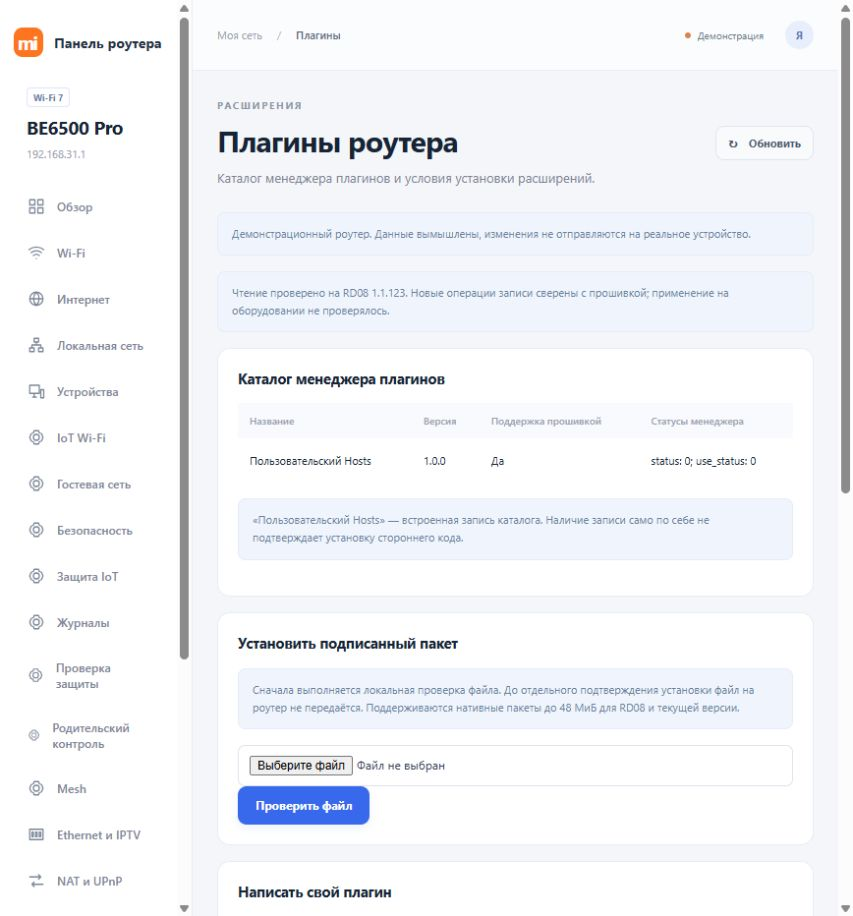

# Xiaomi BE6500 Pro Panel

Русскоязычная панель управления **Xiaomi BE6500 Pro (RD08)**. Работает на вашем компьютере и обращается к штатному API роутера. Устанавливать что-либо на роутер, получать root/SSH или входить в Xiaomi Account для обычного управления не нужно.

Текущая версия — **1.2.0**. Чтение и предпросмотр настроек проверены на **RD08 с китайской прошивкой 1.1.123**. Реальное применение новых команд на устройстве пока не проверено. На других версиях прошивки панель разрешает только чтение. **BE6500 без Pro (RN02) — другая модель.**



## Что можно делать

В панели 20 разделов:

| Область | Возможности |
| --- | --- |
| Обзор и устройства | Состояние сети, клиенты, трафик, имена устройств, доступ в интернет и ограничения скорости |
| Wi-Fi | Диапазоны, каналы, мощность, Smart Connect, MLO, TWT, Beamforming, пороги сигнала, отдельные гостевая и IoT-сети |
| Интернет и локальная сеть | WAN/PPPoE, IPv6, LAN/DHCP, постоянные адреса, Ethernet/IPTV, Dual WAN, агрегация портов |
| Доступ и защита | NAT, UPnP, DMZ, списки доступа, защита от атак, URL-политики, защита IoT, журналы и проверка конфигурации |
| Семья и Mesh | Родительский контроль, расписания и квоты приложений, топология Mesh, поиск узлов и привязка клиентов |
| Сервисы | Штатные VPN/DDNS/QoS, расписания перезапуска и Wi-Fi, WPS PBC, тест скорости |
| Система | Время, светодиоды, NFC, пароль администратора, резервная копия, восстановление, перезапуск, сброс и обновление |
| Плагины | Каталог, локальная проверка подписанных пакетов и исходники примера плагина |

Доступность отдельных функций зависит от прошивки, режима сети и разрешений штатного API. Подробности — в [матрице функций](FUNCTION-MATRIX.csv) и [результатах проверки](docs/VERIFICATION.txt).

## Быстрый запуск в Windows

1. Установите [Node.js](https://nodejs.org/) версии **22 или новее**.
2. [Скачайте репозиторий ZIP-архивом](https://github.com/ISAIandCO/Xiaomi-BE6500PRO-Panel/archive/refs/heads/main.zip) и распакуйте его. Компьютер должен иметь доступ к роутеру по локальной сети.
3. Один раз запустите **Setup.cmd**. Укажите адрес роутера; по умолчанию это `192.168.31.1`.
4. Настройка покажет отпечаток сертификата SHA-256. Откройте `https://192.168.31.1` (или свой адрес) в браузере, откройте сведения о сертификате и сравните его отпечаток SHA-256. Подтвердите совпадение словом `ДОВЕРЯЮ`.
5. Запустите **Start.cmd**. Откроется [http://127.0.0.1:18650](http://127.0.0.1:18650).
6. Введите **пароль администратора роутера** — тот, которым входите в штатную веб-панель. Он может отличаться от пароля Wi-Fi.

Остановка — **Stop.cmd**. Это останавливает только панель на компьютере; роутер продолжает работать.

Установка npm-пакетов и сборка не требуются. Если Node.js только что установлен и команда не находится, откройте окно терминала заново.

## Запуск через терминал, Linux и macOS

```sh
git clone https://github.com/ISAIandCO/Xiaomi-BE6500PRO-Panel.git
cd Xiaomi-BE6500PRO-Panel
npm run setup
npm start
```

Откройте `http://127.0.0.1:18650`. Для остановки нажмите `Ctrl+C`. Сервер использует стандартные модули Node.js; Windows-скрипты запуска отдельно проверялись на Windows, запуск на Linux/macOS не проверялся.

## Первичная настройка и смена адреса

`Setup.cmd` / `npm run setup` создаёт **локальный** `router-config.json`. Пароль при настройке не запрашивается. До подтверждения сертификата настройка выполняет только TLS-соединение и не отправляет логин или команды роутеру.

Если конфигурация уже существует, настройка её не перезаписывает. Для повторной настройки остановите панель, переименуйте свой `router-config.json` и повторите процедуру. При смене LAN-адреса можно изменить `host` в этом файле; при смене сертификата проверьте устройство и выполните настройку повторно.

Для ручной настройки есть [router-config.example.json](router-config.example.json): скопируйте его в `router-config.json`, укажите свой адрес и настоящий SHA-256 сертификата. Значение-заглушка из примера для подключения не подходит. `port` — локальный порт панели, а не порт роутера. Не меняйте `writeFirmware` для обхода режима только чтения.

## Как менять настройки

Сначала панель показывает предпросмотр изменения. Команда отправляется только после нажатия **«Применить»**, а опасные операции дополнительно требуют точную фразу подтверждения. Если связь пропала после применения, проверьте фактическое состояние перед повтором.

Изменение Wi-Fi, WAN или LAN может отключить вас от сети. Перед восстановлением, сбросом или обновлением сохраните резервную копию отдельно. Передача файла прошивки штатному загрузчику уже может остановить плагины; запись прошивки подтверждается отдельным шагом. Между шагами не загружайте другой файл через штатный интерфейс: хранилище загрузчика у роутера общее.

## Известные ограничения

- Полного соответствия всем облачным функциям Xiaomi Home нет. Новые VPN-движки, произвольные пакеты и контейнеры через штатный веб-API не устанавливаются.
- На проверенном устройстве не работает выдача разрешения для добавления URL-исключения; Hosts SDK отклоняет обычного администратора. Панель показывает отказ, а не успешное изменение.
- Для условного управления Bluetooth Mesh нужен собственный miIO-токен. Веб-пароль его не заменяет; этот путь на реальном устройстве пока не проверен.
- Пример в [examples/rd08-status](examples/rd08-status/README.txt) — **исходный код**, а не готовый устанавливаемый пакет. Для нативной установки требуется совместимый пакет с доверенными подписями Xiaomi.
- Настройки провайдера, второй узел Mesh, реальные новые записи, WPS-сопряжение, установка плагинов, смена пароля, прошивка, сброс и перезапуск требуют отдельной проверки на оборудовании. Предпросмотр не доказывает успешность применения.

## Данные и приватность

Сервер слушает только `127.0.0.1`. Браузер и сервер работают на одном компьютере; запросы к роутеру отправляет локальный сервер по HTTPS с проверкой закреплённого отпечатка сертификата. Пароль администратора, токены и сеансы не сохраняются в файлы и обрабатываются в памяти сеанса. Внешние CDN, аналитика и облачный сервер панели не используются.

Локальный `router-config.json` исключён из Git. Не публикуйте его, свои резервные копии, журналы и сетевые дампы: они могут содержать сведения о вашей сети. Тестовые адреса, MAC, пароли и токены в `test/` — вымышленные данные; открытые ключи Xiaomi и константы протокола нужны для проверки форматов и не являются пользовательскими секретами.

## Можно ли разместить на GitHub Pages?

**Рабочую панель в текущем виде — нет.** [GitHub Pages](https://docs.github.com/en/pages/getting-started-with-github-pages/what-is-github-pages) раздаёт статические HTML/CSS/JS и не запускает необходимый Node.js-сервер. Файлы `public/` обращаются к локальным `/api/*`, которые реализованы в `server.mjs`.

При переписывании на прямые запросы из браузера понадобилось бы разрешение со стороны роутера по [CORS](https://developer.mozilla.org/en-US/docs/Web/HTTP/Guides/CORS). Проверенные без авторизации HTTP-ответ и HTTPS OPTIONS на RD08 1.1.123 не содержали `Access-Control-Allow-Origin`. Дополнительно действуют ограничения сертификатов и HTTPS/HTTP; в Chrome доступ к локальной сети требует [Local Network Access](https://developer.chrome.com/blog/local-network-access), которое само по себе не отменяет CORS. `mode: no-cors` не даёт читать ответы API.

Pages подходит для инструкции, скриншотов или отдельной демонстрации. Управление можно сохранить через локальный помощник, но он всё равно должен работать на компьютере. Текущая панель уже открывает интерфейс локально; удалённый origin намеренно не разрешён.

## Разработка

```sh
npm test
```

Тесты используют вымышленные ответы и локальные серверы. Демонстрация без подключения к роутеру:

```sh
node test/preview.mjs
```

Откройте `http://127.0.0.1:18651`; пароль для демонстрации — `panel-test`. Остановка — `Ctrl+C`.

Обработчики панели находятся в корне, интерфейс — в `public/`, тесты — в `test/`. [Материалы исследования](docs/research/README.md) описывают контракты штатного API и ограничения. Реальные выгрузки сети, конфигурации, APK, прошивки и сторонние SDK в репозиторий не включены.

Лицензия — [GNU GPL v3](LICENSE). Это независимый проект, не официальный продукт Xiaomi.
